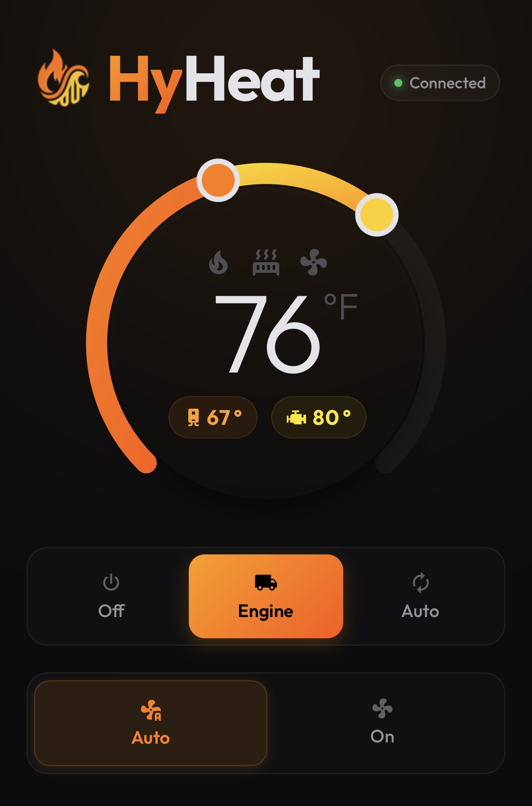

<div align="center">


# HyHeat

</div>

**HyHeat** is a premium, state-of-the-art ESP32-based smart thermostat system designed specifically for campervans and RVs equipped with a hydronic furnace (e.g., Webasto, Eberspächer, or Aqua-Hot) plumbed in line with the engine's coolant loop.

By utilizing dual-thermostat climate logic, HyHeat seamlessly harvests "free" waste engine heat while driving or hot-camping, automatically transitioning back to the combustion furnace only when needed. It hosts a gorgeous, glassmorphic **Progressive Web App (PWA)** directly from the ESP32's flash storage, allowing full-screen offline-capable dashboard control on mobile phones or tablets.

<div align="center">
  
</div>

---

## 🌟 Key Features

- **Dual-Thermostat Logic**:
  - **Engine Heat Thermostat**: Actively monitors the engine coolant loop. When coolant is hot (e.g., above 55°C), it leverages this "free" waste heat by running only the matrix fan, allowing a configurable cabin temperature overshoot to store thermal energy.
  - **Furnace Thermostat**: Safely fires up the hydronic combustion furnace and matrix fan when waste engine heat is unavailable.
- **Equipment Protection & Safety**:
  - Strict configurable minimum runtimes (e.g., 15 minutes for the furnace to prevent short-cycling and carbon build-up).
  - Configurable hysteresis/deadbands and overrun values to minimize relay chatter.
- **Self-Healing Sensor Health Check**:
  - Dedicated automated interval checks monitor temperature readings.
  - If a sensor bus lockup or `NaN` reading is detected for 10 consecutive cycles (100 seconds), a dedicated power GPIO pin performs a hard power-cycle of the sensor bus to automatically recover.
- **Luxury Glassmorphic PWA Web Interface**:
  - Served directly from the ESP32 via a custom high-performance `web_host` ESPHome component.
  - Premium Outfit typography, fluid interactive double-handle temperature dial, SVG-rendered active glows, and hardware-accelerated animations.
  - Fully installable PWA with full-screen standalone capability, custom assets, service worker caching, and theme styling.
- **Real-time UDP Telemetry**:
  - Pushes InfluxDB line-protocol statistics via UDP for instant Grafana/InfluxDB dashboard visualization.
  - Tracks uptime, exact duty times for the fan and furnace, sensor readings, and setpoints.
  - IP and port are dynamically configurable inside the web interface without re-flashing, persisting to flash and applied at boot.
- **OTA Firmware Updates**: Supported natively via ESPHome.

---

## 🔌 Hardware Architecture

HyHeat runs on an **ESP32 DevKit** board connected to two relays and two temperature sensors. An **ESP32 Silicon Revision 3.0 or higher** (e.g., `ESP32-D0WD-V3` / `ESP32-D0WDR2-V3`) is required due to ESP-IDF compiler and memory optimizations configured in `hyheat.yaml` (`minimum_chip_revision: "3.0"` and `sram1_as_iram: true`).

### 1. Temperature Sensors

- **Cabin Sensor (DHT22)**: Placed in the living/sleeping quarters. Measures ambient cabin temperature and relative humidity. Powered via the switched power rail (`GPIO21`) to allow automated hard power-cycles on communication failure. Requires a **4.7kΩ–10kΩ pull-up resistor** between the data line (`GPIO18`) and 3.3V.
- **Heater Loop Sensor (NTC Thermistor)**: Placed on the engine coolant line entering the interior heat exchanger. Wired in an **upstream series voltage divider**:
  $$\text{GPIO21 (3.3V Switched Power)} \longrightarrow 2.2\text{k}\Omega\text{ Resistor} \longrightarrow \text{GPIO34 (ADC)} \longrightarrow \text{NTC Thermistor (10k}\Omega\text{, } B=3950) \longrightarrow \text{GND}$$
  Calibrated using ESPHome's native **Steinhart-Hart** converter filter.

### 2. Relays

- **Furnace Relay**: Controls the hydronic furnace ignition line. Flipped on and kept on for the duration of the burn cycle.
- **Fan Relay**: Powers the matrix heat-exchanger fan, allowing it to run independently when engine waste heat is harvested or in furnace-only mode.

### 3. GPIO Pinout (Default Configuration)

| Pin        | Function          | Description                                                                              |
| :--------- | :---------------- | :--------------------------------------------------------------------------------------- |
| **GPIO18** | Cabin Temp Input  | Connected to the DHT22 data line (requires 4.7kΩ–10kΩ pull-up to 3.3V)                   |
| **GPIO34** | Heater Temp Input | ADC input connected between 2.2kΩ reference resistor and NTC thermistor                 |
| **GPIO21** | Sensor Power      | Switched 3.3V power rail for DHT22 and NTC divider; power-cycles for automated recovery* |
| **GPIO16** | Furnace Relay     | High triggers hydronic furnace burn                                                      |
| **GPIO17** | Fan Relay         | High triggers matrix radiator fan                                                        |
| **GPIO23** | Status LED        | System diagnostic LED indicator                                                          |

> [!NOTE]
> \* **Sensor Power (`GPIO21`):** Direct ESP32 GPIO drive is sufficient for the combined current draw of the DHT22 and NTC voltage divider (<2mA). If using an external high-side transistor or MOSFET switch, ensure very low on-resistance ($R_{\text{DS(on)}}$) or negligible voltage drop so the 3.3V ADC reference voltage calculation remains accurate.

---

## 🛠️ ESPHome Configuration & Setup

HyHeat is designed to be cleanly integrated directly into your central ESPHome configuration environment as an **ESPHome Package**. This allows you to keep your credentials and secrets isolated from the core code, and pull upstream updates cleanly without git conflicts.

### 1. File Structure

```text
├── hyheat.yaml              # Core ESPHome package definition (reusable)
├── LICENSE                  # MIT License
├── README.md                # This documentation
├── data/
│   └── htdocs/              # Static web interface files
│       ├── thermostat.html  # Main glassmorphic interface
│       ├── sw.js            # PWA service worker
│       ├── manifest.webmanifest # PWA configuration manifest
│       ├── apple-touch-icon.png # App icon
│       ├── icon-96.png      # App icon (96x96)
│       └── favicon.ico      # Multi-resolution favicon bundle
```

### 2. ESPHome Package Integration (Recommended)

To install HyHeat, create an extending YAML configuration file (e.g., `hyheat.yaml`). Include the base `hyheat.yaml` package, and supply your keys/passwords via secrets.

#### Example Configuration (`ESPHome/config/hyheat.yaml`):

```yaml
packages:
  hyheat: github://gongloo/HyHeat/hyheat.yaml@2.2.0

# WiFi credentials for your local network
wifi:
  ssid: !secret wifi_ssid
  password: !secret wifi_password

# Enable Home Assistant API with secrets
api:
  encryption:
    key: !secret api_encryption_key

# OTA configuration with secrets
ota:
  - platform: esphome
    password: !secret ota_password
```

### 3. Compile and Flash

You can compile and flash your configuration using either the graphical ESPHome Web Dashboard or the command-line interface.

#### Option A: ESPHome Web Dashboard (Graphical UI)

If you run ESPHome as a Home Assistant Add-on or host a standalone ESPHome dashboard:

1. Open the **ESPHome Dashboard** in your web browser.
2. Click **New Device** (or click **Edit** on your device card), paste your custom extending YAML configuration, and click **Save**.
3. Click **Install** on the device card:
   - Select **Wirelessly** (for subsequent upgrades only) to update over-the-air (OTA).
   - Select **Plug into this computer** (to flash directly from your web browser using WebUSB) or **Plug into the computer running ESPHome** (to flash via the host server's physical USB port).

#### Option B: Command-Line Interface (CLI)

If you prefer managing configurations in the terminal, navigate to your ESPHome working directory and execute:

```bash
# Verify the configuration syntax is correct
esphome config hyheat.yaml

# Compile the firmware and upload it to your ESP32
esphome run hyheat.yaml
```

Once flashed, the ESP32 will connect to your WiFi network and host the web interface at `http://hyheat.local/thermostat` or via its assigned DHCP IP address.

---

## 📲 Web Interface & PWA Installation

The PWA is designed with a premium, mobile-first dashboard aesthetic:

- **Dial Control**: The outer ring acts as a double-handle dial. Grab the **Orange handle** to adjust the Furnace Setpoint and the **Gold handle** to adjust the Engine Waste Heat Setpoint.
- **Operating Modes**:
  - **Off**: Turns all thermostats and demands off.
  - **Engine**: Turns on only the Engine Heat Thermostat (runs fan using waste coolant heat).
  - **Auto**: Standard smart thermostat operation. Runs the matrix fan on engine heat if coolant $>55^\circ\text{C}$; if coolant drops and cabin is cold, it fires up the furnace.
- **Fan Mode**: Toggle between **Auto** (thermostat-controlled fanning) and **On** (continuous cabin air circulation).

### 📱 Installing on Mobile Devices (iOS & Android)

1.  Navigate to `http://hyheat.local/thermostat` in Safari (iOS) or Chrome (Android).
2.  Tap the **Share** button (iOS) or the **Menu** button (Android).
3.  Select **Add to Home Screen**.
4.  HyHeat will now appear on your device's home screen with the beautiful premium icon and run in standalone, full-screen mode like a native app.

---

## 📊 UDP Telemetry Payload

HyHeat sends real-time statistics in InfluxDB line-protocol format. The payload is constructed and optimized to fit into a single MTU:

```text
hyheat,host=hyheat furnace_relay=F,fan_relay=T,fan_override=F,has_residual_heat=T,engine_thermostat_on=T,furnace_thermostat_on=T,uptime=3624i,fan_on_s=120i,furnace_on_s=0i,cabin_temp=21.4,cabin_humidity=42.1,heater_loop_temp=62.8,furnace_target_temp=19.0,engine_target_temp=24.0,min_residual_heat=55.0,cabin_temp_offset=0
```

Destination IP and port are configurable via the web interface under **UDP Configuration (Restart Required)** and saved to non-volatile storage (NVS), taking effect whenever the device boots or restarts. You can point these packets to a UDP listener in InfluxDB (port `8089` by default) to build dashboards monitoring fuel efficiency, heating duties, and temperature curves in real time.
